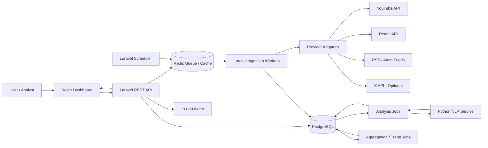
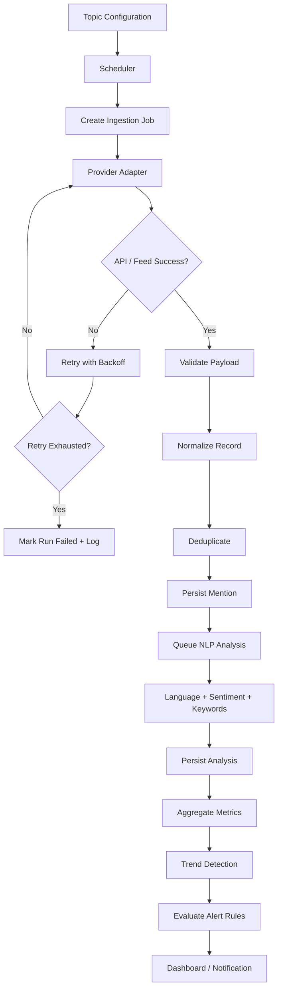

# PulseScope — PRD & Technical Specification

> **Produk:** Social Listening, Sentiment Analysis, dan Trend Intelligence Dashboard  
> **Dokumen:** Product Requirements Document (PRD) + Software Requirements / Technical Specification  
> **Status:** Draft baseline untuk implementasi  
> **Versi:** 1.0  
> **Tanggal:** 6 November 2026  
> **Bahasa produk:** Indonesia (English-ready)  
> **Zona waktu default:** Asia/Jakarta (WIB)

---

## 1. Ringkasan Produk

PulseScope adalah platform social listening yang mengumpulkan percakapan publik dari sumber digital yang terhubung secara resmi, mengelompokkan percakapan berdasarkan topik, menganalisis sentimen, mendeteksi lonjakan pembahasan, dan menyajikan insight dalam dashboard yang mudah dipahami.

Pengguna dapat memantau kata kunci, brand, produk, isu, event, maupun topik umum. Sistem menampilkan volume percakapan dari waktu ke waktu, distribusi sentimen, topik yang sedang naik, kata kunci yang sering muncul bersama, sumber percakapan, serta contoh konten publik yang menjadi bukti insight.

**Prinsip produk:** PulseScope bukan sekadar grafik jumlah posting. Produk harus membantu pengguna menjawab:

1. Apa yang sedang dibicarakan?
2. Topik apa yang mulai meningkat dan seberapa cepat peningkatannya?
3. Bagaimana kecenderungan sentimen publik terhadap topik tersebut?
4. Di platform atau sumber mana percakapan paling aktif?
5. Konten dan kata kunci apa yang mendorong perubahan tersebut?
6. Apakah perubahan itu cukup signifikan untuk diberi perhatian?

### 1.1 Batasan penting

Tidak ada jaminan bahwa satu aplikasi dapat membaca seluruh konten dari semua media sosial. Setiap platform memiliki API, izin, kuota, biaya, batas pencarian, dan ketentuan penyimpanan data yang berbeda. Karena itu:

- Integrasi harus menggunakan API resmi, feed yang diizinkan, atau penyedia data yang memiliki hak akses yang sesuai.
- Dilarang menjadikan scraping halaman web, bypass login, bypass CAPTCHA, atau penggunaan akun palsu sebagai strategi pengumpulan data.
- Status konektor harus transparan: `Connected`, `Needs Configuration`, `Approval Required`, `Rate Limited`, `Degraded`, atau `Disconnected`.
- Dashboard tidak boleh menampilkan data simulasi seolah-olah merupakan data live. Data demo harus diberi label **DEMO DATA**.
- Ketersediaan, volume, dan cakupan data harus ditampilkan agar angka tidak disalahartikan sebagai representasi seluruh opini publik.

---

## 2. Product Vision

Menjadi pusat pemantauan percakapan digital yang mengubah data publik yang tersebar menjadi informasi tren dan sentimen yang dapat ditindaklanjuti, dengan fokus awal pada bahasa Indonesia dan konteks Indonesia.

### 2.1 Positioning

**PulseScope = Social Listening + Trend Detection + Sentiment Intelligence.**

Bukan social media management tool untuk menjadwalkan posting, membalas komentar, atau mengelola kalender konten. Fokus utamanya adalah observasi, analisis, dan peringatan dini terhadap percakapan.

### 2.2 Target pengguna

| Persona | Kebutuhan utama | Contoh penggunaan |
|---|---|---|
| Brand / Marketing Analyst | Menilai percakapan dan persepsi terhadap brand atau produk | Memantau nama brand, kampanye, dan keluhan |
| Public Relations / Communications | Mendeteksi isu dan perubahan sentimen | Melihat lonjakan percakapan negatif |
| Researcher / Mahasiswa | Mengamati tren percakapan publik | Menganalisis isu sosial atau respons terhadap event |
| Community / Product Team | Menemukan masukan, pertanyaan, dan masalah berulang | Mengidentifikasi fitur yang sering dikeluhkan |
| Management / Executive | Mendapatkan ringkasan situasi tanpa membaca seluruh posting | Melihat ringkasan tren mingguan |

### 2.3 Jobs to be Done

- Saat ada isu atau event, pengguna ingin mengetahui apakah jumlah pembahasannya meningkat.
- Saat brand disebut, pengguna ingin melihat apakah percakapan cenderung positif, netral, atau negatif.
- Saat muncul topik baru, pengguna ingin mengetahui kata kunci dan konten yang memicu topik tersebut.
- Saat indikator melewati ambang batas, pengguna ingin menerima alert beserta bukti dan konteksnya.
- Saat membuat laporan, pengguna ingin mengekspor grafik dan ringkasan dengan rentang waktu serta sumber yang jelas.

---

## 3. Tujuan, Non-Goals, dan Indikator Keberhasilan

### 3.1 Product goals

1. Mengumpulkan konten publik dari konektor yang telah dikonfigurasi dan diizinkan.
2. Menormalisasi data lintas-platform ke dalam format yang konsisten.
3. Menghitung volume percakapan dan distribusi sentimen.
4. Mendeteksi topik atau keyword yang mengalami kenaikan aktivitas.
5. Menampilkan bukti berupa mention publik yang relevan.
6. Memberikan alert berdasarkan aturan yang dapat dikonfigurasi.
7. Menyediakan data provenance: sumber, waktu pengambilan, status konektor, dan tingkat keyakinan analisis.

### 3.2 Non-goals untuk versi awal

- Membaca DM, pesan privat, grup tertutup, atau konten yang aksesnya tidak diberikan.
- Mengakses seluruh akun atau seluruh posting pada suatu platform.
- Menjamin data benar-benar real-time untuk semua platform.
- Mengelola atau mempublikasikan konten ke akun media sosial.
- Mengidentifikasi orang di balik akun anonim atau melakukan deanonymization.
- Membuat skor risiko, profil personal, atau inferensi atribut sensitif seseorang.
- Menganggap hasil sentimen sebagai survei opini publik yang representatif secara statistik.
- Melakukan prediksi viralitas dengan klaim kepastian.

### 3.3 North Star Metric

**Actionable Insights Viewed per Active Workspace per Week** — jumlah insight tren/isu yang dibuka oleh pengguna aktif dan memiliki sumber bukti yang dapat ditelusuri.

### 3.4 Supporting metrics

- Data ingestion success rate per konektor.
- Persentase data dengan timestamp dan source URL valid.
- Median ingestion delay per platform.
- Persentase mention yang berhasil dianalisis.
- Sentiment model evaluation: macro F1 dan confusion matrix pada dataset evaluasi berbahasa Indonesia.
- Trend alert precision: proporsi alert yang dinilai relevan oleh pengguna.
- Waktu muat dashboard (p95).
- Jumlah error konektor, retry, dan rate-limit events.

---

## 4. Asumsi dan Strategi Integrasi Sumber Data

### 4.1 Prioritas integrasi

Implementasi harus memiliki **provider adapter layer** agar penambahan platform tidak mengubah domain logic, API dashboard, atau struktur analisis.

| Sumber | Prioritas | Rencana integrasi | Catatan akses |
|---|---:|---|---|
| YouTube | P0 | YouTube Data API v3: pencarian video, detail video, dan statistik yang diizinkan | Kuota API berlaku. `search.list` memiliki batas kuota yang perlu diperhitungkan; konfigurasi kuota dapat berubah. Komentar hanya diambil jika endpoint, izin, dan kuota mendukung. |
| Reddit | P0/P1 | Reddit Data API menggunakan OAuth dan akses yang disetujui | Penggunaan eksternal/komersial dapat memerlukan persetujuan atau akses komersial. Wajib menangani penghapusan post/comment dan aturan retensi data. |
| RSS / sumber berita | P0 | RSS/Atom feed yang secara eksplisit tersedia untuk konsumsi | Hormati robots/terms, rate limit, atribusi, dan hak cipta. Simpan metadata secukupnya; jangan menyalin artikel penuh tanpa hak. |
| X | P1 | X API sesuai paket dan biaya yang tersedia | Akses berbasis konsumsi/credit dan endpoint/rate limit dapat berubah. Wajib ada budget limit dan usage meter. |
| Threads | P2 | Adapter opsional jika akses pencarian publik tersedia untuk app yang disetujui | Fitur pencarian publik dan izin dapat memiliki persyaratan akses/verifikasi. Jangan mengandalkan sebelum diuji dengan app credentials. |
| Instagram | P2 | Integrasi sesuai kemampuan Instagram Graph API dan izin aplikasi | Jangan mengasumsikan pencarian seluruh hashtag atau seluruh konten publik tersedia. Periksa izin dan use case yang disetujui. |
| TikTok | P2 | Hanya jika akses Research/Commercial API yang sesuai benar-benar disetujui | TikTok Research API memiliki kriteria kelayakan dan persetujuan. Bukan akses umum untuk setiap aplikasi komersial atau developer. |
| Sumber tambahan | P2 | Provider baru melalui interface adapter | Tambahkan hanya setelah legalitas, akses, kualitas, dan biaya diverifikasi. |

**Rekomendasi MVP:** mulai dengan YouTube + RSS, lalu Reddit setelah persetujuan akses dan peninjauan kebijakan selesai. X menjadi integrasi opsional yang memerlukan persetujuan anggaran. Jangan menunda pengembangan seluruh produk hanya karena akses TikTok/Instagram belum tersedia.

### 4.2 Data source capability matrix

Setiap konektor harus mendeklarasikan kemampuan aktualnya, misalnya:

```json
{
  "provider": "youtube",
  "capabilities": {
    "keyword_search": true,
    "public_content": true,
    "comments": false,
    "public_metrics": true,
    "historical_backfill": "limited",
    "streaming": false
  },
  "access_status": "connected",
  "last_success_at": "2026-11-06T00:00:00+07:00"
}
```

Nilai di atas hanya contoh kontrak data, bukan pernyataan bahwa seluruh endpoint sudah tersedia.

### 4.3 Data provenance

Setiap record harus menyimpan sekurangnya:

- Platform/provider.
- External content ID.
- URL sumber jika disediakan platform.
- Waktu konten dibuat oleh platform (`published_at`).
- Waktu sistem mengambil data (`collected_at`).
- Waktu terakhir sinkronisasi metadata (`last_fetched_at`).
- Metode pengumpulan (API, RSS, atau provider resmi).
- Status validasi dan status penghapusan.

---

## 5. Ruang Lingkup Fitur

Prioritas menggunakan label:

- **P0:** wajib tersedia untuk MVP.
- **P1:** penting setelah alur MVP stabil.
- **P2:** pengembangan lanjutan.

### 5.1 Authentication dan workspace

| ID | Fitur | Prioritas | Kriteria ringkas |
|---|---|---:|---|
| AUTH-01 | Login | P0 | Pengguna dapat login dan logout secara aman. |
| AUTH-02 | Workspace | P0 | Data dan konfigurasi dipisahkan per workspace. |
| AUTH-03 | Role-based access | P0 | Minimal Owner, Admin, Analyst, Viewer. |
| AUTH-04 | Invite member | P1 | Admin dapat mengundang anggota workspace. |
| AUTH-05 | Audit log | P1 | Perubahan konfigurasi dan akses penting tercatat. |

### 5.2 Topic monitoring

| ID | Fitur | Prioritas | Kriteria ringkas |
|---|---|---:|---|
| TOPIC-01 | Buat topik | P0 | Pengguna memberi nama dan deskripsi topik. |
| TOPIC-02 | Keyword inclusion | P0 | Mendukung satu atau lebih kata/frasa. |
| TOPIC-03 | Exclusion keyword | P0 | Pengguna dapat mengecualikan kata yang tidak relevan. |
| TOPIC-04 | Boolean query | P1 | Mendukung AND/OR/NOT dengan parser yang terdokumentasi. |
| TOPIC-05 | Platform selection | P0 | Pengguna memilih konektor aktif untuk topik. |
| TOPIC-06 | Language filter | P1 | Filter bahasa Indonesia, Inggris, dan unknown. |
| TOPIC-07 | Location filter | P2 | Hanya jika sumber menyediakan lokasi yang sah dan cukup akurat. |
| TOPIC-08 | Topic pause/archive | P0 | Topik dapat dijeda atau diarsipkan tanpa menghapus histori yang wajib dipertahankan. |

**Contoh konfigurasi topik:**

```json
{
  "name": "Kualitas Layanan Brand X",
  "include_keywords": ["Brand X", "layanan Brand X", "aplikasi Brand X"],
  "exclude_keywords": ["lowongan", "karir"],
  "match_mode": "any",
  "language_filters": ["id", "en"],
  "providers": ["youtube", "reddit", "rss"],
  "is_active": true
}
```

### 5.3 Overview dashboard

| ID | Komponen | Prioritas | Perilaku |
|---|---|---:|---|
| DASH-01 | Total mentions | P0 | Jumlah item unik yang cocok dengan filter dan periode. |
| DASH-02 | Mention change | P0 | Perubahan terhadap periode pembanding yang setara. |
| DASH-03 | Sentiment distribution | P0 | Positive, Neutral, Negative, Unknown. |
| DASH-04 | Sentiment timeline | P0 | Tren sentimen dari waktu ke waktu. |
| DASH-05 | Mention volume timeline | P0 | Jumlah percakapan per interval. |
| DASH-06 | Platform breakdown | P0 | Distribusi mention per platform/sumber. |
| DASH-07 | Trending topics | P0 | Topik dengan momentum pertumbuhan tinggi. |
| DASH-08 | Top keywords | P0 | Kata/frasa yang sering muncul setelah normalisasi. |
| DASH-09 | Recent mentions | P0 | Sampel konten yang relevan, dapat dibuka ke sumber aslinya. |
| DASH-10 | Data freshness | P0 | Menampilkan kapan masing-masing konektor terakhir berhasil sinkron. |
| DASH-11 | Geographic map | P2 | Hanya dari data lokasi yang diberikan secara eksplisit dan sah. |
| DASH-12 | AI executive summary | P1 | Ringkasan berbasis data dengan tautan ke bukti sumber. |

### 5.4 Sentiment analysis

| ID | Fitur | Prioritas | Kriteria ringkas |
|---|---|---:|---|
| SENT-01 | Classification | P0 | Klasifikasi positive, neutral, negative, unknown. |
| SENT-02 | Confidence score | P0 | Menyimpan probabilitas/tingkat keyakinan model. |
| SENT-03 | Low-confidence handling | P0 | Prediksi di bawah threshold menjadi `unknown` atau perlu review. |
| SENT-04 | Language detection | P1 | Mendeteksi bahasa untuk menentukan jalur model. |
| SENT-05 | Human correction | P1 | Analyst dapat mengoreksi hasil dengan alasan opsional. |
| SENT-06 | Aspect sentiment | P2 | Sentimen berdasarkan aspek, misalnya harga, layanan, kualitas. |
| SENT-07 | Sarcasm/context handling | P2 | Eksperimen khusus, tidak boleh diklaim akurat tanpa evaluasi. |

**Ketentuan analisis:**

- Fokus awal pada Bahasa Indonesia informal, campuran Indonesia-Inggris, slang, singkatan, emoji, negasi, dan typo umum.
- Model harus dievaluasi menggunakan dataset berlabel yang relevan dengan domain dan periode penggunaan.
- Jangan menyamakan sentimen sebuah kalimat dengan sikap permanen pemilik akun.
- `unknown` adalah hasil valid, bukan error. Gunakan ketika teks terlalu pendek, ambigu, hanya URL, bahasa tidak didukung, atau confidence rendah.
- Sarkasme, ironi, konteks percakapan, dan komentar satu kata memiliki risiko salah klasifikasi tinggi.
- Dashboard harus menyediakan tooltip yang menjelaskan bahwa sentimen merupakan estimasi model.

### 5.5 Trending topic detection

| ID | Fitur | Prioritas | Kriteria ringkas |
|---|---|---:|---|
| TREND-01 | Keyword frequency | P0 | Menghitung frekuensi kata/frasa setelah normalisasi. |
| TREND-02 | Rising keywords | P0 | Mengidentifikasi kata dengan peningkatan relatif terhadap baseline. |
| TREND-03 | Trend score | P0 | Menghasilkan skor momentum 0–100 yang dapat dijelaskan. |
| TREND-04 | Topic clustering | P1 | Mengelompokkan mention yang mirip berdasarkan semantic similarity. |
| TREND-05 | Novel topic | P1 | Mendeteksi kelompok pembahasan yang belum umum pada baseline. |
| TREND-06 | Cross-platform trend | P1 | Mengukur apakah pembahasan muncul di beberapa sumber. |
| TREND-07 | Trend explanation | P1 | Menampilkan alasan skor meningkat, periode, dan contoh mention. |

### 5.6 Alert dan report

| ID | Fitur | Prioritas | Kriteria ringkas |
|---|---|---:|---|
| ALERT-01 | Volume spike alert | P0 | Alert ketika volume melewati threshold. |
| ALERT-02 | Negative sentiment alert | P0 | Alert saat jumlah atau proporsi sentimen negatif naik signifikan. |
| ALERT-03 | Trending keyword alert | P1 | Alert saat keyword melewati skor momentum tertentu. |
| ALERT-04 | Alert cooldown | P0 | Mencegah notifikasi berulang untuk kejadian yang sama. |
| ALERT-05 | In-app notifications | P0 | Alert terlihat di dashboard. |
| ALERT-06 | Email/Telegram notification | P2 | Integrasi kanal notifikasi tambahan. |
| REPORT-01 | Export CSV | P0 | Mengekspor data sesuai filter dan izin pengguna. |
| REPORT-02 | Export PDF | P1 | Mengekspor ringkasan, grafik, sumber, periode, dan catatan metodologi. |
| REPORT-03 | Saved report | P2 | Menyimpan konfigurasi laporan. |

---

## 6. User Journey Utama

### 6.1 Membuat monitoring baru

1. Pengguna login.
2. Pengguna masuk ke halaman Topics.
3. Pengguna membuat topik, misalnya `Isu Transportasi Publik`.
4. Pengguna menambahkan keyword dan exclusion keyword.
5. Pengguna memilih sumber yang statusnya sudah `Connected`.
6. Sistem memvalidasi konfigurasi dan menampilkan perkiraan keterbatasan sumber.
7. Sistem menjadwalkan ingestion sesuai kemampuan dan rate limit konektor.
8. Dashboard menampilkan status `Collecting data` sampai data pertama tersedia.
9. Setelah data terkumpul, sistem memproses sentimen dan tren.

### 6.2 Menelusuri lonjakan tren

1. Pengguna membuka kartu `Rising Topics`.
2. Pengguna memilih salah satu topik yang sedang naik.
3. Sistem menampilkan grafik volume, trend score, dan pembanding baseline.
4. Pengguna melihat kata/frasa pendorong dan distribusi platform.
5. Pengguna membuka beberapa mention sebagai bukti.
6. Pengguna dapat membuat alert atau mengekspor laporan.

### 6.3 Meninjau alert sentimen negatif

1. Sistem mendeteksi kenaikan mention negatif.
2. Sistem memeriksa minimum volume, confidence, dan cooldown.
3. Sistem membuat alert dengan severity dan penjelasan.
4. Pengguna membuka alert.
5. Pengguna melihat perubahan volume, contoh mention, sumber, dan keterbatasan data.
6. Pengguna dapat menandai alert sebagai `Acknowledged`, `Resolved`, atau `False Positive`.

---

## 7. Informasi Arsitektur dan Tech Stack

### 7.1 Rekomendasi stack

Stack ini dipilih agar implementasi realistis, mudah dipelihara, dan sesuai pola pengembangan web modern.

| Layer | Teknologi rekomendasi | Tanggung jawab |
|---|---|---|
| Frontend | React + TypeScript + Vite | SPA dashboard |
| UI | Tailwind CSS + shadcn/ui | Design system dan komponen |
| Data fetching | TanStack Query + Axios | Cache, query, retry, dan API client |
| Chart | Apache ECharts atau Recharts | Time series, stacked chart, bar chart, heatmap |
| Backend API | Laravel | Authentication, workspace, RBAC, topic, dashboard API, alerts, exports |
| Database | PostgreSQL | Data utama dan analitik terstruktur |
| Cache / Queue | Redis + Laravel Horizon | Cache, background jobs, rate limiting, ingestion jobs |
| NLP service | Python + FastAPI | Language detection, sentiment inference, keyword extraction, embeddings |
| Scheduler | Laravel Scheduler | Menjalankan jadwal sinkronisasi |
| Deployment | Docker Compose + Nginx | Environment development dan production |
| Observability | Laravel logs + structured logs + Prometheus/Grafana (opsional) | Monitoring sistem dan worker |

**Catatan arsitektur:** Laravel menjadi control plane dan pemilik business logic. Python NLP service hanya menyediakan fungsi pemrosesan teks melalui internal API. Jangan memecah sistem menjadi banyak microservices pada MVP.

### 7.2 High-level architecture



### 7.3 Deployment topology

Untuk MVP dapat menggunakan satu VPS dengan Docker Compose:

- `frontend`: static build disajikan Nginx.
- `api`: Laravel PHP-FPM atau Laravel application container.
- `web`: Nginx reverse proxy.
- `worker`: Laravel queue worker.
- `scheduler`: Laravel scheduler process.
- `postgres`: database.
- `redis`: queue dan cache.
- `nlp`: FastAPI inference service, tidak diekspos ke internet publik.

Untuk production, database dan Redis idealnya memiliki volume persisten, backup terpisah, health checks, serta kebijakan resource limit. NLP service bisa dipisahkan ke mesin lain ketika konsumsi CPU/RAM meningkat.

---

## 8. Data Pipeline dan Processing Flow

### 8.1 Pipeline



### 8.2 Aturan ingestion

- Setiap provider adapter harus mengimplementasikan interface yang sama.
- Simpan cursor/checkpoint per konektor dan query agar pagination tidak mengulang seluruh data.
- Gunakan external ID + provider sebagai unique key untuk idempotency.
- Terapkan request timeout, retry exponential backoff dengan jitter, dan circuit breaker.
- Hormati `Retry-After`, quota response, serta rate limit header jika tersedia.
- Batasi jumlah job paralel per provider.
- Jangan mengulang request permanen yang gagal karena permission atau invalid credential tanpa tindakan admin.
- Simpan `ingestion_runs` untuk audit dan debugging.
- Simpan status konektor dan waktu keberhasilan terakhir.
- Sediakan dead-letter/failure state agar kegagalan tidak hilang diam-diam.

### 8.3 Normalisasi data

Normalisasi minimal:

- Unicode normalization.
- Trim whitespace dan konsistensi newline.
- Deteksi bahasa.
- Simpan `text_original` dan `text_normalized` sesuai kebijakan retensi sumber.
- URL canonicalization jika aman dan relevan.
- Deduplication berdasarkan `(provider, external_id)`.
- Near-duplicate detection opsional menggunakan hash teks/embedding.
- Jangan menghapus emoji dari teks sebelum sentiment inference; buat salinan bersih terpisah untuk keyword extraction.
- Jangan menganggap repost/share sebagai percakapan unik tanpa aturan agregasi yang eksplisit.

### 8.4 Deduplication

**Primary deduplication key:** `provider + external_id`.

**Secondary near-duplicate key (opsional):** hash dari teks yang telah dinormalisasi, provider, dan rentang waktu pendek. Near-duplicate harus menjadi penanda, bukan otomatis menghapus konten, karena dua pengguna dapat menyampaikan teks yang mirip secara independen.

### 8.5 Data retention dan deletion

- Buat retention policy per provider karena ketentuan platform berbeda.
- Sediakan job yang memeriksa konten yang dihapus atau tidak lagi tersedia.
- Ketika provider memberi sinyal penghapusan, hapus konten dan seluruh turunan yang wajib dihapus: salinan teks, embedding, hasil analisis yang dapat dikaitkan, cache, dan export sementara.
- Jangan menyimpan profil pengguna lebih dari kebutuhan minimum.
- Hindari menyimpan avatar, email, nomor telepon, atau atribut personal yang tidak dibutuhkan.
- Terapkan TTL untuk raw content dan log yang berisi payload sensitif.
- Retensi historis agregat hanya boleh dilakukan jika diperbolehkan ketentuan sumber dan hukum yang berlaku.
- Sediakan prosedur penghapusan manual untuk admin ketika ada laporan penghapusan atau koreksi.

---

## 9. Spesifikasi Analisis Sentimen dan Tren

### 9.1 Sentiment classification

Output standar:

```json
{
  "label": "negative",
  "confidence": 0.87,
  "probabilities": {
    "positive": 0.04,
    "neutral": 0.09,
    "negative": 0.87
  },
  "model_version": "sentiment-id-v1",
  "analyzed_at": "2026-11-06T00:00:00+07:00"
}
```

Angka pada contoh hanya ilustrasi.

**Threshold awal yang dapat dikonfigurasi:**

- `confidence >= 0.70`: gunakan label model.
- `confidence < 0.70`: label `unknown` atau review.
- Threshold harus dikalibrasi melalui evaluation set, bukan dianggap angka ilmiah universal.

**Tantangan Bahasa Indonesia yang wajib diuji:**

- Negasi: `nggak bagus`, `tidak buruk`, `belum memuaskan`.
- Slang: `wkwk`, `b aja`, `parah sih`, `mantul`, `zonk`.
- Campur bahasa: `service-nya slow banget`.
- Emoji dan tanda baca berulang.
- Sarkasme: `pelayanannya cepat sekali, cuma nunggu 3 jam`.
- Konteks reply/thread jika tersedia secara sah.
- Konten pendek: `setuju`, `parah`, `mantap`, `lah`.

**Evaluasi minimum sebelum menyebut model layak:**

- Dataset evaluasi dipisah dari data training.
- Laporkan macro F1, precision, recall, dan confusion matrix.
- Laporkan hasil per kelas; jangan hanya accuracy.
- Lakukan error analysis pada slang, negasi, sarkasme, dan domain tertentu.
- Catat versi model dan preprocessing untuk reproducibility.

### 9.2 Keyword extraction

MVP:

1. Lowercase untuk salinan analisis.
2. Tokenisasi dan stopword removal untuk Bahasa Indonesia dan Inggris.
3. Pertahankan entity/keyword penting yang relevan dengan topik.
4. Ekstraksi unigram dan bigram.
5. Ranking berdasarkan frequency dan TF-IDF terhadap baseline.

P1:

- Keyphrase extraction berbasis model.
- Entity extraction.
- Semantic clustering untuk menggabungkan variasi istilah yang konteksnya mirip.

Hindari hanya menggunakan word cloud sebagai hasil utama. Daftar keyword harus bisa diklik untuk membuka mention pendukung.

### 9.3 Trend score

Trend score merupakan indikator momentum percakapan, bukan ukuran viralitas universal.

Hitung pada interval yang dapat dikonfigurasi, misalnya 15 menit atau 1 jam. Bandingkan volume terbaru dengan baseline yang sebanding.

Komponen yang disarankan:

| Komponen | Bobot awal | Makna |
|---|---:|---|
| Volume | 25% | Besarnya jumlah mention pada window terbaru |
| Growth rate | 35% | Kenaikan terhadap baseline periode pembanding |
| Acceleration | 20% | Perubahan growth rate dari window sebelumnya |
| Source diversity | 10% | Distribusi kemunculan pada beberapa sumber yang tersedia |
| Persistence | 10% | Apakah kenaikan bertahan pada beberapa window |

Bobot dan normalisasi harus dapat dikonfigurasi dan dievaluasi menggunakan data historis.

Contoh rumus konseptual:

```text
trend_score = 100 * (
  0.25 * normalized_volume +
  0.35 * normalized_growth +
  0.20 * normalized_acceleration +
  0.10 * normalized_source_diversity +
  0.10 * normalized_persistence
)
```

Semua komponen dinormalisasi ke rentang 0–1 dengan batas robust (misalnya persentil historis), bukan min-max dari satu window yang mudah berubah.

**Baseline:**

- Bandingkan 1 jam terakhir dengan rata-rata/median jam sejenis pada 7 hari sebelumnya jika data mencukupi.
- Bila data historis belum cukup, gunakan baseline sementara dan tampilkan status `Insufficient baseline`.
- Abaikan spike dengan volume sangat kecil menggunakan minimum mention threshold.
- Tampilkan ukuran sampel bersama skor.
- Hindari membandingkan angka lintas-platform secara mentah karena coverage, populasi, dan metode pencarian berbeda.

Contoh tampilan penjelasan:

> Trend score 82/100 — volume mention meningkat 3,4× dibanding baseline 7 hari, terutama dari YouTube dan Reddit. Sampel: 146 mention dalam 1 jam. Data RSS belum tersedia untuk topik ini.

Nilai di atas adalah contoh UI, bukan data aktual.

### 9.4 Topic clustering

Untuk P1, kelompokkan mention menggunakan embeddings dan clustering (misalnya HDBSCAN atau metode serupa). Setiap cluster minimal memiliki:

- Nama/ringkasan cluster yang dapat diedit.
- Keyword dominan.
- Jumlah mention.
- Sentiment distribution.
- First seen dan last seen.
- Representative mentions.
- Confidence/kualitas cluster.

Cluster bukan kategori kebenaran. Sediakan kemampuan merge, split, rename, dan dismiss jika hasil otomatis tidak tepat.

### 9.5 Ringkasan berbasis AI

Ringkasan harus dibuat dari agregat dan mention yang benar-benar tersimpan, bukan dari asumsi model. Setiap klaim penting harus ditautkan ke mention atau metrik pendukung.

Guardrails:

- Jangan membuat kutipan, nama sumber, angka, atau peristiwa yang tidak ada pada data.
- Jika data sedikit, tulis bahwa bukti belum cukup.
- Pisahkan fakta observasi (`volume naik`) dari interpretasi (`kemungkinan dipicu oleh...`).
- Hindari inferensi identitas atau atribut sensitif individu.
- Jangan menyajikan sentimen sampel sebagai opini seluruh masyarakat.

---

## 10. Information Architecture dan UI/UX

### 10.1 Navigasi utama

```text
PulseScope
├── Overview
├── Explore
│   ├── Mentions
│   ├── Trending Topics
│   └── Keywords
├── Monitors
│   ├── All Topics
│   └── Create Monitor
├── Alerts
├── Reports
├── Data Sources
└── Settings
    ├── Workspace
    ├── Members & Roles
    ├── Retention & Privacy
    └── Audit Log
```

### 10.2 Halaman Overview

Komposisi halaman:

1. **Header:** workspace, judul `Overview`, filter tanggal, filter topik, filter platform, tombol refresh.
2. **Data coverage strip:** konektor aktif, last sync, dan peringatan jika ada sumber yang degraded.
3. **KPI row:** Total Mentions, Mention Growth, Negative Share, Rising Topics.
4. **Primary chart:** mention volume + sentiment timeline.
5. **Secondary row:** sentiment distribution, platform breakdown, top keywords.
6. **Trending panel:** daftar rising topics dengan score, delta, sample count, dan alasan.
7. **Recent mentions:** cuplikan teks, platform, waktu, sentimen, confidence, dan link sumber.

Hindari menaruh terlalu banyak grafik dengan visualisasi yang sama. Setiap panel harus menjawab pertanyaan yang berbeda.

### 10.3 Halaman Topic Detail

- Nama dan status monitoring.
- Keyword inclusion/exclusion.
- Ringkasan topik.
- Volume dan sentimen per waktu.
- Trend score dan pembanding baseline.
- Keyword terkait.
- Platform distribution.
- Mention explorer yang dapat difilter.
- Tombol edit monitor dan create alert.

### 10.4 Halaman Explore / Mentions

Filter:

- Rentang tanggal.
- Workspace topic.
- Provider/platform.
- Sentiment.
- Language.
- Minimum confidence.
- Keyword.

Setiap mention menampilkan:

- Cuplikan teks (dengan batas panjang).
- Platform badge.
- Published timestamp.
- Sentiment label + confidence.
- Keyword/topic match.
- Engagement metric hanya bila provider mengizinkan.
- Tombol `Open source` menuju URL asli.

Jangan menampilkan informasi author yang tidak diperlukan. Jika handle memang disediakan dan boleh ditampilkan, gunakan sebagai metadata opsional, bukan sebagai pusat analisis.

### 10.5 Halaman Data Sources

Setiap konektor menampilkan:

- Nama provider.
- Status akses dan otorisasi.
- Fitur yang tersedia.
- Last successful sync.
- Rate limit/quota usage bila tersedia.
- Jumlah job gagal.
- Estimasi biaya untuk provider berbayar jika dapat dihitung.
- Tombol Configure, Test Connection, Pause, Disconnect.

### 10.6 Design direction

Arah visual: **modern data intelligence / observability dashboard**, bukan dashboard admin generik.

- Visual hierarchy kuat; angka penting mudah dipindai.
- Background netral gelap atau light mode yang konsisten; sediakan theme toggle bila tidak menambah kompleksitas berlebihan.
- Gunakan warna semantik secara konsisten: positive, neutral, negative, warning, info.
- Warna bukan satu-satunya pembeda; gunakan label, ikon, dan pola agar tetap terbaca.
- Gunakan whitespace, grid konsisten, dan ukuran tipografi terukur.
- Chart harus memiliki tooltip, legend, empty state, dan label periode.
- Hindari gradient berlebihan, glassmorphism berlebihan, neon di semua elemen, animasi yang mengganggu, dan dekorasi yang tidak menyampaikan informasi.
- Responsif untuk desktop dan tablet; mobile minimal mendukung monitoring dan membuka alert.

### 10.7 UI states wajib

Setiap halaman penting harus mempunyai:

- Loading skeleton.
- Empty state dengan tindakan berikutnya.
- Error state dengan retry.
- Partial data state ketika satu konektor gagal.
- Stale data indicator.
- Permission denied state.
- Demo data label pada environment demo.

---

## 11. Backend API Specification

Prefix: `/api/v1`  
Format: JSON  
Authentication: session/token mechanism yang dipilih saat implementasi; seluruh endpoint workspace harus melakukan authorization server-side.

### 11.1 Endpoint utama

| Method | Endpoint | Fungsi |
|---|---|---|
| POST | `/auth/login` | Login |
| POST | `/auth/logout` | Logout |
| GET | `/me` | Profil pengguna dan workspace aktif |
| GET | `/workspaces` | Daftar workspace |
| GET/POST | `/workspaces/{id}/topics` | List/create monitor |
| GET/PATCH/DELETE | `/topics/{id}` | Detail/update/archive monitor |
| GET | `/dashboard/overview` | KPI dan summary |
| GET | `/dashboard/timeseries` | Volume/sentiment time series |
| GET | `/trends` | Daftar rising topics/keywords |
| GET | `/mentions` | Mention explorer dengan cursor pagination |
| GET | `/mentions/{id}` | Detail mention yang boleh ditampilkan |
| GET | `/connectors` | Status sumber data |
| POST | `/connectors/{provider}/connect` | Mulai konfigurasi/otorisasi |
| POST | `/connectors/{provider}/test` | Tes koneksi |
| POST | `/connectors/{provider}/pause` | Jeda konektor |
| GET/POST | `/alerts` | List/create alert |
| PATCH | `/alerts/{id}` | Update status/aturan alert |
| GET | `/notifications` | Daftar notifikasi |
| POST | `/reports/export` | Buat export asynchronous |
| GET | `/ingestion/runs` | Riwayat ingestion untuk admin |

### 11.2 Filter umum

```text
?workspace_id=...
&topic_id=...
&provider=youtube,reddit
&from=2026-11-01T00:00:00+07:00
&to=2026-11-06T23:59:59+07:00
&timezone=Asia/Jakarta
```

Validasi tanggal dan workspace wajib dilakukan di server. Gunakan cursor pagination untuk mention dalam dataset besar.

### 11.3 Contoh response overview

```json
{
  "meta": {
    "timezone": "Asia/Jakarta",
    "from": "2026-11-01T00:00:00+07:00",
    "to": "2026-11-06T23:59:59+07:00",
    "generated_at": "2026-11-06T10:00:00+07:00",
    "is_demo": false
  },
  "coverage": {
    "connected_providers": 2,
    "total_configured_providers": 3,
    "last_successful_sync_at": "2026-11-06T09:55:00+07:00",
    "partial_data": true
  },
  "kpis": {
    "total_mentions": 1250,
    "mentions_change_percent": 18.4,
    "negative_share_percent": 24.1,
    "rising_topics_count": 5
  },
  "sentiment": {
    "positive": 410,
    "neutral": 520,
    "negative": 250,
    "unknown": 70
  }
}
```

Semua angka contoh bersifat ilustratif. `partial_data` harus true ketika sumber yang dikonfigurasi gagal atau tidak menyediakan coverage pada periode tersebut.

### 11.4 API conventions

- Gunakan HTTP status code yang sesuai.
- Response error mempunyai `code`, `message`, dan `request_id`.
- Jangan mengembalikan access token, secret, atau internal stack trace.
- Terapkan request validation dan authorization pada setiap endpoint.
- Gunakan consistent date format ISO 8601 dengan timezone.
- Gunakan `request_id` untuk tracing.
- Endpoint export harus asynchronous dan mengembalikan job ID.

---

## 12. Database Design

Gunakan PostgreSQL. Semua tabel domain yang terkait workspace harus memiliki `workspace_id` atau dapat diturunkan secara aman melalui relasi yang tervalidasi.

### 12.1 Entitas inti

| Tabel | Kolom penting | Keterangan |
|---|---|---|
| `users` | id, name, email, password, timestamps | Pengguna |
| `workspaces` | id, name, slug, owner_id, timestamps | Tenant/workspace |
| `workspace_members` | id, workspace_id, user_id, role | Relasi user dan role |
| `topics` | id, workspace_id, name, description, status, config_json | Monitor/topik |
| `topic_keywords` | id, topic_id, keyword, type, match_mode | Include/exclude keyword |
| `connectors` | id, workspace_id, provider, status, capabilities_json | Konfigurasi konektor |
| `connector_credentials` | id, connector_id, encrypted_payload, expires_at | Secret terenkripsi |
| `ingestion_runs` | id, connector_id, topic_id, status, started_at, finished_at, counts_json, error_code | Riwayat ingestion |
| `mentions` | id, workspace_id, provider, external_id, source_url, published_at, collected_at, text, language, deletion_status | Konten publik yang diizinkan |
| `mention_topic_matches` | id, mention_id, topic_id, matched_keywords_json | Relasi mention dengan monitor |
| `mention_metrics` | id, mention_id, captured_at, likes, comments, shares, views | Snapshot metrik jika tersedia |
| `sentiment_results` | id, mention_id, label, confidence, probabilities_json, model_version | Output sentimen |
| `mention_keywords` | id, mention_id, keyword, score | Keyword hasil ekstraksi |
| `trend_snapshots` | id, workspace_id, topic_id, entity, window_start, window_end, score, components_json, sample_count | Skor tren historis |
| `alerts` | id, workspace_id, topic_id, type, threshold_json, cooldown_minutes, is_active | Aturan alert |
| `alert_events` | id, alert_id, status, severity, evidence_json, triggered_at, acknowledged_at | Kejadian alert |
| `notifications` | id, workspace_id, user_id, type, payload_json, read_at | Notifikasi |
| `audit_logs` | id, workspace_id, actor_id, action, target_type, target_id, metadata_json | Audit |

### 12.2 Index dan constraint

- Unique: `(provider, external_id)` pada mentions, dengan pertimbangan namespace yang benar jika data multi-tenant disimpan bersama.
- Index: `workspace_id`, `provider`, `published_at`, `collected_at`, `deletion_status`.
- Index gabungan: `(workspace_id, published_at)` dan `(topic_id, mention_id)` pada tabel relasi.
- Index pada `sentiment_results.label` jika sering difilter.
- Gunakan partition berdasarkan waktu untuk tabel mentions/metrics bila volume membenarkan.
- Foreign key dan cascade behavior harus diputuskan dengan mempertimbangkan kebijakan retensi dan penghapusan sumber.
- Simpan angka agregat dalam tabel snapshot/materialized view bila query dashboard mulai berat.

### 12.3 Catatan data model

- `text` bukan tempat menyimpan seluruh payload mentah provider. Simpan hanya field yang diperlukan.
- Payload mentah hanya boleh disimpan sementara untuk debugging dan harus melalui redaction serta TTL.
- Jangan menyimpan access token dalam tabel konektor tanpa enkripsi.
- Jangan gunakan `author_id` sebagai basis pemprofilan. Jika diperlukan untuk dedup/attribution yang diizinkan, simpan secara minimal dan hapus sesuai kebijakan provider.
- Pisahkan `published_at` dari `collected_at`; keduanya tidak boleh tertukar.

---

## 13. Authorization dan Security

### 13.1 Role matrix

| Aksi | Owner | Admin | Analyst | Viewer |
|---|:---:|:---:|:---:|:---:|
| Lihat dashboard | ✓ | ✓ | ✓ | ✓ |
| Lihat mention | ✓ | ✓ | ✓ | ✓ |
| Buat/edit topic | ✓ | ✓ | ✓ | – |
| Kelola connector/credentials | ✓ | ✓ | – | – |
| Buat/edit alert | ✓ | ✓ | ✓ | – |
| Export report | ✓ | ✓ | ✓ | sesuai kebijakan |
| Kelola anggota | ✓ | ✓ | – | – |
| Hapus workspace | ✓ | – | – | – |
| Lihat audit log | ✓ | ✓ | – | – |

Authorization harus diperiksa di backend, bukan hanya menyembunyikan tombol frontend.

### 13.2 Security baseline

- Hash password dengan algoritma password hashing modern yang didukung framework.
- Enkripsi credential connector saat disimpan.
- Simpan secret dalam environment/secret manager, bukan repository.
- Gunakan HTTPS.
- Terapkan CSRF protection sesuai mode autentikasi, secure cookies, dan CORS allowlist.
- Validasi OAuth state dan redirect URI secara ketat.
- Rate limit login, export, endpoint pencarian, dan endpoint sensitif.
- Cegah IDOR dengan pemeriksaan workspace scope pada setiap query.
- Hindari SQL injection melalui ORM/parameter binding.
- Sanitasi output teks sebelum dirender untuk mencegah XSS.
- Terapkan CSP dan security headers pada frontend.
- Jangan tampilkan credential, raw provider error, atau stack trace ke client.
- Log aktivitas administratif tanpa menyimpan secret atau isi konten yang tidak perlu.
- Lakukan dependency scanning dan backup restore test.

### 13.3 Privacy dan responsible use

- Hanya analisis percakapan publik yang dapat diakses secara sah.
- Jangan memantau pesan privat atau ruang tertutup tanpa otorisasi eksplisit yang sah.
- Jangan membangun fitur untuk melacak pergerakan atau perilaku individu.
- Jangan menyimpulkan ras/etnis, agama, pandangan politik, kesehatan, orientasi seksual, atau atribut sensitif lain dari konten.
- Jangan menjual ulang data mentah platform atau menyediakan data untuk data brokerage.
- Tampilkan kebijakan privasi, tujuan pemrosesan, retensi, dan mekanisme penghapusan.
- Lakukan legal/policy review sebelum mengaktifkan konektor dan sebelum produk dipakai secara komersial.

---

## 14. Non-Functional Requirements (NFR)

Angka berikut merupakan target awal MVP dan harus disesuaikan setelah uji beban.

| ID | Area | Target awal |
|---|---|---|
| NFR-01 | Performance | Endpoint overview p95 ≤ 2,5 detik pada beban uji MVP dengan cache/agregat aktif. |
| NFR-02 | API reliability | API tidak gagal total ketika satu provider mengalami gangguan. |
| NFR-03 | Ingestion | Job bersifat idempotent dan dapat diulang tanpa membuat duplikasi. |
| NFR-04 | Freshness | Tampilkan last sync secara eksplisit; target awal 5–15 menit hanya untuk konektor yang mendukung polling tersebut. |
| NFR-05 | Availability | Target awal 99,5% per bulan untuk layanan aplikasi, di luar gangguan provider eksternal dan maintenance terjadwal. |
| NFR-06 | Scalability | Worker dapat ditambah horizontal tanpa mengubah kontrak domain. |
| NFR-07 | Security | Tidak ada credential di frontend/log/repository. |
| NFR-08 | Tenant isolation | Pengguna tidak dapat membaca data workspace lain. |
| NFR-09 | Accessibility | Kontras, keyboard navigation, dan label chart yang memadai. |
| NFR-10 | Observability | Log terstruktur, request ID, queue metrics, dan connector health. |
| NFR-11 | Data integrity | External ID unik per provider dan timestamp disimpan dalam UTC. |
| NFR-12 | Retention | Penghapusan dan TTL mengikuti kebijakan per provider. |

### 14.1 Capacity target MVP

Desain awal dapat ditargetkan untuk 10.000–50.000 normalized mentions per hari pada deployment kecil, tetapi angka aktual sangat bergantung pada jumlah konektor, kuota API, frekuensi polling, payload, dan kapasitas VPS. Jangan mengklaim kapasitas produksi sebelum load test.

### 14.2 Observability metrics

- `ingestion_jobs_total{provider,status}`
- `ingestion_job_duration_seconds{provider}`
- `provider_requests_total{provider,status_code}`
- `provider_rate_limit_remaining{provider}` jika tersedia
- `mentions_collected_total{provider}`
- `sentiment_jobs_total{status}`
- `sentiment_inference_duration_seconds`
- `queue_lag_seconds`
- `dashboard_api_duration_seconds`
- `alerts_triggered_total{type,severity}`

Jangan memasukkan isi mention, token, atau data personal ke label metric.

---

## 15. Acceptance Criteria MVP

MVP dianggap memenuhi spesifikasi bila seluruh kriteria P0 berikut lulus.

### 15.1 Workspace dan topic

- [ ] Pengguna dapat login/logout.
- [ ] Workspace memiliki isolasi data yang tervalidasi di backend.
- [ ] Pengguna dengan role yang sesuai dapat membuat, mengedit, menjeda, dan mengarsipkan topic.
- [ ] Topic mendukung include keyword, exclude keyword, dan pilihan konektor.
- [ ] Sistem menolak konektor yang belum memiliki konfigurasi/izin dengan pesan yang jelas.

### 15.2 Ingestion

- [ ] Minimal satu konektor nyata berhasil mengambil data melalui API/feed yang sah.
- [ ] Sistem menyimpan provider, external ID, source URL, published timestamp, dan collected timestamp.
- [ ] Mengulang ingestion tidak membuat duplikasi.
- [ ] Kegagalan provider tidak menghentikan konektor lain.
- [ ] Status konektor dan last successful sync terlihat di UI.
- [ ] Rate limit dan retry ditangani.
- [ ] Data demo diberi label dan tidak dicampur dengan data produksi.

### 15.3 Sentiment dan trend

- [ ] Mention yang memenuhi syarat masuk ke pipeline sentiment.
- [ ] Output sentiment menyimpan label, confidence, dan model version.
- [ ] Low-confidence dapat menghasilkan `unknown`.
- [ ] Dashboard menunjukkan volume mention dan sentiment distribution.
- [ ] Sistem menghitung rising keyword/trend dengan baseline yang dinyatakan.
- [ ] Setiap trend dapat ditelusuri ke mention sampel.
- [ ] UI menjelaskan bahwa sentiment dan trend score adalah estimasi analitik.

### 15.4 Dashboard dan alert

- [ ] Filter periode, topic, dan provider bekerja konsisten pada seluruh widget.
- [ ] Grafik menampilkan empty, loading, error, dan partial-data state.
- [ ] Recent mentions dapat dibuka ke sumber asli jika URL tersedia.
- [ ] Alert volume spike dan negative sentiment dapat dikonfigurasi.
- [ ] Cooldown mencegah alert berulang secara berlebihan.
- [ ] User dapat menandai alert acknowledged/resolved.

### 15.5 Security dan privacy

- [ ] Tidak ada endpoint lintas-workspace yang dapat diakses tanpa izin.
- [ ] Connector secret tidak dikirim ke frontend.
- [ ] Token/secret tidak muncul di log.
- [ ] Proses penghapusan konten dapat diuji.
- [ ] Retention policy dapat dijalankan otomatis.

---

## 16. Test Strategy

### 16.1 Backend tests

- Unit test untuk keyword matching dan exclusion.
- Unit test untuk normalisasi teks dan deduplication.
- Unit test untuk trend score dan baseline.
- Unit test untuk sentiment threshold handling.
- Feature test untuk authorization workspace dan role.
- Feature test untuk dashboard filter dan pagination.
- Integration test provider menggunakan mocked HTTP responses.
- Test retry, timeout, rate limit, invalid token, dan partial failure.
- Test deletion cascade dan retention job.

### 16.2 NLP evaluation

Buat dataset uji berlabel Bahasa Indonesia yang mencakup:

- Berita/isu umum.
- Review produk dan layanan.
- Keluhan pelanggan.
- Slang dan singkatan.
- Negasi.
- Sarkasme.
- Komentar pendek.
- Campuran Indonesia-Inggris.

Pisahkan data train/validation/test. Catat asal data dan pastikan penggunaannya diizinkan. Jangan menganggap hasil dari dataset kecil sebagai generalisasi untuk seluruh media sosial.

### 16.3 Frontend tests

- Component tests untuk KPI, chart state, filter, mention card, dan alert card.
- E2E flow: login → create topic → connect source → view dashboard → open mention → create alert.
- Responsive test pada desktop, tablet, dan mobile.
- Accessibility check untuk keyboard dan kontras.

### 16.4 Load and resilience tests

- Uji dashboard dengan data sintetis yang volumenya realistis.
- Uji pagination mentions.
- Uji lonjakan queue job.
- Uji database index dan aggregation query.
- Uji provider timeout dan outage.
- Uji worker restart saat job berjalan.

---

## 17. Roadmap Implementasi

### Phase 0 — Foundation

- Setup repository dan Docker Compose.
- Setup Laravel, React, PostgreSQL, Redis, dan Python NLP service.
- Setup authentication, workspace, RBAC, audit dasar.
- Setup design system, layout, navigation, dan demo data berlabel.

**Exit criteria:** aplikasi dapat dijalankan lokal dengan satu perintah dokumentasi, login bekerja, dan workspace isolation lulus test.

### Phase 1 — MVP Monitoring Core

- CRUD topic dan keyword rules.
- Provider adapter interface.
- Implementasi RSS/Atom adapter dan/atau YouTube API adapter.
- Ingestion scheduler + queue + idempotency.
- Mention explorer.
- Overview KPI dan time series.
- Provider health/status.

**Exit criteria:** data nyata dari minimal satu sumber sah terlihat di dashboard dan dapat ditelusuri ke sumber.

### Phase 2 — Sentiment & Trend Intelligence

- Python NLP inference service.
- Sentiment pipeline dan evaluation report.
- Keyword extraction.
- Trend score dan baseline.
- Rising topics panel.
- Alert rules dan in-app notifications.

**Exit criteria:** hasil analisis menyimpan model version/confidence, trend dapat dijelaskan, dan alert dapat diuji.

### Phase 3 — Multi-source & Reporting

- Reddit adapter setelah akses disetujui.
- X adapter jika anggaran dan API access tersedia.
- Cross-source comparison.
- CSV/PDF export.
- AI summary dengan evidence links.

**Exit criteria:** kegagalan satu sumber tidak mengganggu sumber lain dan report menyertakan periode/metodologi/cakupan sumber.

### Phase 4 — Advanced Intelligence

- Semantic clustering.
- Topic novelty detection.
- Aspect-based sentiment.
- Advanced alert routing.
- P2 connectors sesuai persetujuan dan kemampuan API.

---

## 18. Risiko dan Mitigasi

| Risiko | Dampak | Mitigasi |
|---|---|---|
| API platform berubah atau dibatasi | Data berhenti masuk | Provider adapter, connector health, contract tests, dan fallback source |
| Biaya API meningkat | Pengeluaran tidak terkendali | Budget cap, usage meter, polling interval, dan alert biaya |
| Data tidak representatif | Insight menyesatkan | Coverage indicator, sampling caveat, baseline, dan dokumentasi metodologi |
| Sentiment salah klasifikasi | Kesimpulan keliru | Confidence threshold, unknown class, manual correction, evaluation dataset |
| Spam/duplikasi | Trend score bias | Deduplication, source weighting, dan minimum sample threshold |
| Sarkasme/slang lokal | Akurasi model turun | Evaluation set berkonteks Indonesia dan error analysis |
| Konten dihapus di sumber | Ketidakpatuhan kebijakan | Deletion sync, retention job, dan cascading purge |
| Credential bocor | Penyalahgunaan API | Encryption, secret manager, least privilege, dan audit |
| Dashboard lambat | Pengalaman buruk | Aggregation snapshots, caching, indexes, dan pagination |
| Ringkasan AI berhalusinasi | Informasi salah | Evidence-backed generation dan abstention bila data tidak cukup |

---

## 19. Definition of Done

Sebuah fitur dinyatakan selesai jika:

1. Kode memenuhi standar struktur dan naming repository.
2. Validasi input dan authorization backend tersedia.
3. Loading, empty, error, dan partial states tersedia pada UI yang relevan.
4. Unit/integration test penting lulus.
5. Tidak ada credential atau data rahasia pada source code/log.
6. API contract dan environment variable terdokumentasi.
7. Migrasi database dapat dijalankan dari kondisi fresh install.
8. Fitur dapat diuji dengan data demo yang diberi label atau konektor nyata yang terkonfigurasi.
9. Keterbatasan data dan metodologi analitik dijelaskan kepada pengguna.

---

## 20. Instruksi Implementasi untuk Coding Agent

Dokumen ini menjadi baseline requirement, bukan alasan untuk langsung menghasilkan semua fitur sekaligus. Ikuti urutan berikut:

### 20.1 Sebelum coding

1. Inspeksi repository yang tersedia: framework, struktur folder, dependency, pola routing, autentikasi, komponen UI, database, dan test yang sudah ada.
2. Jangan mengganti stack atau menghapus implementasi yang masih berfungsi tanpa alasan teknis yang kuat.
3. Identifikasi gap antara kondisi repo dan spesifikasi ini.
4. Buat implementation plan yang memecah pekerjaan ke milestone kecil dan dapat diverifikasi.
5. Identifikasi kebutuhan API credentials dan tandai integrasi yang belum bisa diuji tanpa approval/secret.
6. Bila repository kosong, scaffold proyek sesuai stack rekomendasi pada bagian 7.

### 20.2 Saat implementasi

- Implementasikan end-to-end slice: database → backend → frontend → test.
- Bangun provider adapter contract sebelum menambah banyak konektor.
- Mulai dari satu sumber data nyata yang aksesnya tersedia; sediakan mock provider untuk test saja.
- Jangan membuat UI yang mengklaim data live ketika memakai fixtures.
- Jangan menaruh business logic trend/sentiment di komponen frontend.
- Simpan rumus trend dan preprocessing dalam modul yang teruji.
- Gunakan migration, seed, factory, dan test secara konsisten.
- Hindari overengineering dan microservices tambahan yang belum dibutuhkan.
- Semua external integration harus punya timeout, retry policy, observability, dan dokumentasi batas akses.

### 20.3 Setelah implementasi setiap milestone

- Jalankan formatter, static analysis, unit tests, integration tests, dan build.
- Jalankan migration pada database kosong.
- Verifikasi role dan tenant isolation.
- Uji empty state dan konektor gagal.
- Periksa browser console dan backend logs.
- Laporkan fitur selesai, bukti test, keterbatasan, dan pekerjaan yang belum dapat dilakukan.

### 20.4 Deliverables yang harus dihasilkan agent

- Source code aplikasi.
- Database migrations dan seed/demo data.
- `.env.example` tanpa secret.
- Docker Compose dan konfigurasi Nginx bila dibutuhkan.
- API documentation (OpenAPI/Swagger atau dokumentasi setara).
- README setup lokal dan deployment.
- Test suite.
- Dokumentasi connector setup dan API permission.
- Dokumen metodologi sentiment/trend dan hasil evaluasi model.

---

## 21. Open Decisions

Keputusan berikut dapat dibuat setelah repository dan kebutuhan deployment diperiksa. Coding agent tidak boleh berpura-pura bahwa keputusan ini sudah dikonfirmasi.

| Keputusan | Default sementara | Kapan perlu diubah |
|---|---|---|
| Nama produk | PulseScope | Bila ada nama produk final |
| Target pengguna | Analyst/researcher dan tim komunikasi | Bila fokusnya enterprise atau personal |
| Sumber P0 | YouTube + RSS; Reddit setelah approval | Bergantung credentials dan izin |
| X integration | Optional, cost-controlled | Bila tersedia anggaran API |
| Bahasa analisis | Indonesia dan Inggris | Bila target multibahasa |
| Deployment | Docker Compose pada satu VPS | Bila traffic/worker sudah memerlukan pemisahan |
| Data retention | Per-provider policy; default konservatif | Mengikuti kontrak, kebijakan platform, dan hukum |
| AI summary | P1, evidence-backed | Bila biaya/model dan kualitas sudah tervalidasi |

---

## 22. Referensi Teknis dan Kebijakan Platform

Dokumentasi berikut harus diperiksa kembali sebelum implementasi konektor karena endpoint, eligibility, kuota, biaya, serta kebijakan dapat berubah.

1. **YouTube Data API — Search: list**  
   https://developers.google.com/youtube/v3/docs/search/list  
   Referensi pencarian video/channel/playlist, parameter query, pagination, dan kuota.
2. **YouTube Data API — Overview / Quota usage**  
   https://developers.google.com/youtube/v3/getting-started  
   Referensi kuota API dan proses permintaan tambahan kuota.
3. **Reddit Data API Wiki**  
   https://support.reddithelp.com/hc/en-us/articles/16160319875092-Reddit-Data-API-Wiki  
   Referensi rate limit, OAuth, dan kewajiban terkait konten yang dihapus.
4. **Reddit Developers — FAQ**  
   https://developers.reddit.com/docs/guides/faq  
   Referensi akses external Data API dan kebutuhan persetujuan untuk penggunaan komersial.
5. **Reddit Developer Rules**  
   https://developers.reddit.com/docs/devvit_rules  
   Referensi privasi, minimisasi data, penggunaan konten, penghapusan, dan pembatasan pemrosesan.
6. **X Developer Platform**  
   https://developer.x.com/  
   Referensi model harga berbasis penggunaan dan akses API. Periksa harga aktual sebelum mengaktifkan integrasi.
7. **TikTok Research API**  
   https://developers.tiktok.com/products/research-api/  
   Referensi eligibility dan proses approval Research Tools.
8. **TikTok Research API — FAQ**  
   https://developers.tiktok.com/doc/research-api-faq/  
   Referensi quota, approval, dan keterbatasan data Research API.

---

## 23. Product Acceptance Statement

PulseScope MVP berhasil apabila pengguna dapat membuat monitor topik, menghubungkan setidaknya satu sumber data yang sah, melihat percakapan publik yang berhasil dikumpulkan, memahami distribusi sentimen beserta confidence-nya, menemukan keyword/tren yang meningkat berdasarkan baseline yang jelas, menelusuri bukti ke sumber asli, dan menerima alert ketika kondisi terukur terpenuhi.

**Prinsip akhir:** lebih baik menampilkan data yang cakupannya terbatas tetapi transparan dan dapat diverifikasi daripada menampilkan angka besar yang tampak real-time namun sumber, izin, dan metodologinya tidak jelas.
